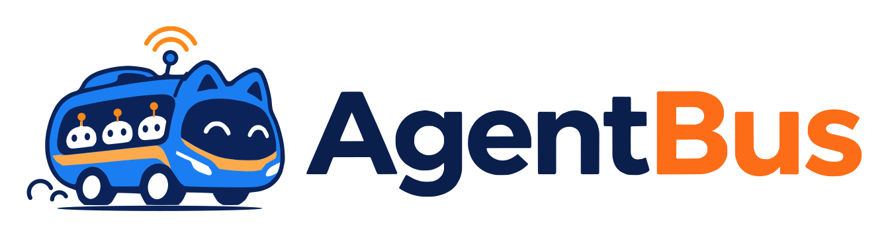

<div align="center">

<picture>
  <source media="(prefers-color-scheme: dark)" srcset="docs/assets/agentbus-logo-dark.svg">
  
</picture>

# AgentBus cockpit

**A free, self-hosted browser cockpit for [AgentBus](https://github.com/staysup/agentbus).**

[](https://github.com/staysup/agentbus-cockpit/stargazers)
[](https://github.com/staysup/agentbus-cockpit/releases)
[](https://github.com/StaysUp/agentbus-cockpit/actions/workflows/ci.yml)

[Run it](#run) &nbsp;&bull;&nbsp; [AgentBus](https://github.com/staysup/agentbus) &nbsp;&bull;&nbsp; [Releases](https://github.com/staysup/agentbus-cockpit/releases)

</div>

A free, self-hosted browser cockpit for [AgentBus](https://github.com/staysup/agentbus). It shows
your agents' turns, every model call, its cost, and the full conversation.

The cockpit is a client of the AgentBus API. It uses only the public client API, so
anything it shows, your own program can read too.

## Prerequisites

- Node.js 20.19 or later in the 20 line, or 22.12 or later. Vite needs one of these.
- A running AgentBus service (`agentbus up`). See the
  [AgentBus README](https://github.com/staysup/agentbus#quickstart).

## Run

1. Start AgentBus:

   ```sh
   agentbus up
   ```

   Any browser origin may call it, because every call needs the token. To allow only the cockpit,
   start it with `agentbus up -origin http://localhost:5173` instead. That origin must then match
   exactly: open the cockpit at `localhost`, not `127.0.0.1`, or pass that origin.

2. In this folder, install and start the cockpit:

   ```sh
   npm ci
   npm run dev
   ```

3. Open `http://localhost:5173`.

4. Connect. The service address is filled in as `http://127.0.0.1:8787`. For the token, copy the
   contents of the `token` file in the data folder that `agentbus up` printed at start, by default
   `~/.local/share/agentbus/token`. On macOS:

   ```sh
   pbcopy < ~/.local/share/agentbus/token
   ```

   On Linux, print it and copy it from the terminal:

   ```sh
   cat ~/.local/share/agentbus/token
   ```

   With `$AGENTBUS_HOME` set, the token is in that folder instead. With only `$XDG_DATA_HOME` set,
   it is in `$XDG_DATA_HOME/agentbus`.

   Paste it into the Token field and press Connect.

**Use recorded data** opens the cockpit on a recorded sample, with no service needed.

## Build a static copy

```sh
npm run build
```

This writes `dist/`. Serve it from any static host. Plain `agentbus up` accepts it; to lock the
service to that host, pass its origin to `agentbus up -origin`.

## Test

```sh
npm test
```

## License

Free to use, change and run, including inside your business. You can't sell it as a competing product or service. Each release becomes Apache 2.0 two years after it is published.

Licensed under the [Functional Source License](https://fsl.software) (FSL-1.1-ALv2). See [LICENSE](LICENSE).
